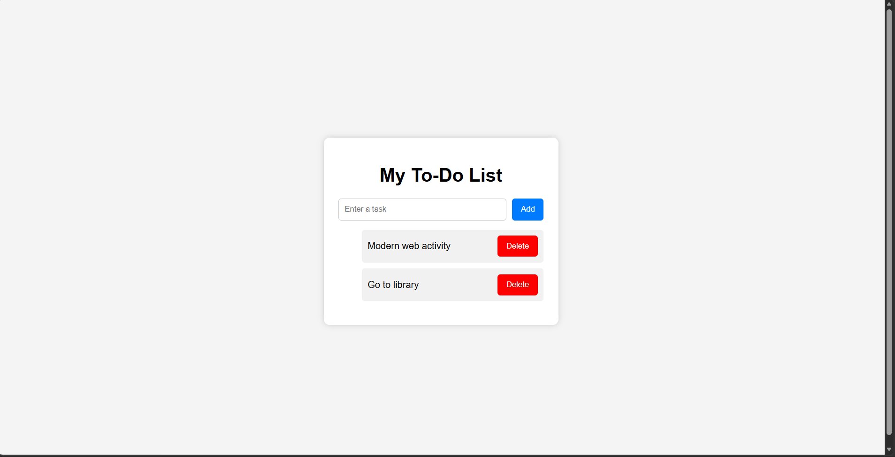

# Ex03 To-Do List using JavaScript
## Date:17/11/26

## AIM
To create a To-do Application with all features using JavaScript.

## ALGORITHM
### STEP 1
Build the HTML structure (index.html).

### STEP 2
Style the App (style.css).

### STEP 3
Plan the features the To-Do App should have.

### STEP 4
Create a To-do application using Javascript.

### STEP 5
Add functionalities.

### STEP 6
Test the App.

### STEP 7
Open the HTML file in a browser to check layout and functionality.

### STEP 8
Fix styling issues and refine content placement.

### STEP 9
Deploy the website.

### STEP 10
Upload to GitHub Pages for free hosting.

## PROGRAM
```

<!DOCTYPE html>
<html lang="en">
<head>
    <meta charset="UTF-8">
    <meta name="viewport" content="width=device-width, initial-scale=1.0">
    <title>To-Do List</title>
    <link rel="stylesheet" href="style.css">
</head>
<body>

    <div class="container">
        <h1>My To-Do List</h1>

        <div class="input-box">
            <input type="text" id="taskInput" placeholder="Enter a task">
            <button onclick="addTask()">Add</button>
        </div>

        <ul id="taskList"></ul>
    </div>

    <script src="script.js"></script>
</body>
</html>

```

## OUTPUT


## RESULT
The program for creating To-do list using JavaScript is executed successfully.
